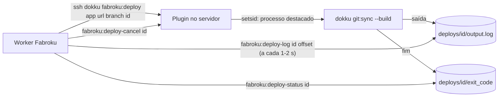

# Plano: deploy desacoplado da conexão SSH (plugin Dokku `fabroku`)

**Status:** aprovado pelo orientador em 28/10/2026 e implementado (plugin 0.1.0 + backend
atrás da flag `DOKKU_REMOTE_DEPLOY_PLUGIN`). Diferenças da implementação em relação a este
plano estão na seção 11.
**Data:** 28/10/2026

## 1. Problema

Hoje o Fabroku faz o build dos apps mantendo uma conexão SSH aberta até o fim:
o worker roda `dokku git:sync --build <app> <url> <branch>` com terminal (PTY) e lê
a saída linha a linha (`Fabroku_Backend/src/infrastructure/adapters/dokku_mixins/dokku_git.py`,
método `sync_git_streaming`, via `ssh.py` `_run_command_streaming`).

Se a conexão cai no meio, o servidor encerra o processo do Dokku junto. Isso acontece em
três situações comuns:

| Situação | Exemplo |
|---|---|
| Deploy cancelado pelo usuário | botão "Cancelar deploy" mata a task com SIGTERM |
| Worker reiniciado | deploy do próprio Fabroku, OOM, limite de 30 min do Celery |
| Rede | queda entre o worker e o servidor Dokku |

Consequências observadas ou prováveis:

1. **Container parado preso ao volume de cache** (observado em 28/10 no app
   `babycorporation-backend`): o container da fase `release:` terminou, mas o Dokku foi
   morto antes de removê-lo, e `apps:destroy` passou a falhar com "volume is in use".
   Hoje há um paliativo (`dokku cleanup <app>` antes de tentar apagar de novo).
2. **Status errado no painel:** o Fabroku perde o resultado do build.
3. **Banco migrado com código antigo (o pior caso, inferido):** se a conexão cai depois
   que a fase `release:` rodou as migrations e antes dos containers novos substituírem os
   antigos, o banco fica na versão nova e o código no ar fica na antiga.

Usar `dokku logs` não resolve: ele mostra os logs do app rodando, não a saída do build.

## 2. Objetivo

O build roda no servidor **independente da conexão SSH**. O Fabroku só:

- inicia o deploy e recebe um ID na hora;
- lê o log por partes, a partir de uma posição (offset);
- consulta o estado (rodando, sucesso, falha, cancelado);
- pede cancelamento, que o servidor executa de forma controlada.

Assim, cancelar, reiniciar o worker ou perder a rede não interrompe o build, e o log fica
completo no servidor.

## 3. Arquitetura

O plugin é um plugin Dokku comum, instalado uma vez no servidor com
`sudo dokku plugin:install <url-do-repo> --name fabroku`. Os comandos ficam disponíveis pelo
mesmo SSH que o Fabroku já usa (`ssh dokku@servidor fabroku:deploy ...`), sem acesso extra.

## 4. Comandos do plugin (contrato)

Todas as respostas são JSON numa linha, para o Fabroku interpretar sem depender de texto.

| Comando | O que faz | Resposta |
|---|---|---|
| `fabroku:version` | Versão do plugin (o Fabroku usa para saber se o plugin existe) | `{"version":"0.1.0"}` |
| `fabroku:deploy <app> <git-url> <branch> <deploy-id>` | Valida os argumentos, trava o app, inicia o build destacado e retorna na hora | `{"id":"...","state":"running"}` ou erro `{"error":"app_busy"}` |
| `fabroku:deploy-log <deploy-id> <offset> [max-bytes]` | Devolve o pedaço do log a partir do byte `offset` | `{"offset":1234,"next_offset":2048,"chunk":"<base64>"}` |
| `fabroku:deploy-status <deploy-id>` | Estado atual do deploy | `{"state":"running\|succeeded\|failed\|cancelled\|lost","exit_code":0,"started_at":"...","finished_at":"..."}` |
| `fabroku:deploy-cancel <deploy-id>` | SIGTERM no grupo de processos, SIGKILL após 30 s, roda `dokku cleanup <app>` e marca como cancelado | `{"state":"cancelled"}` |
| `fabroku:gc [dias]` | Apaga diretórios de deploy finalizados mais velhos que N dias (padrão: 7) | `{"removed":12}` |

**Arquivos por deploy** em `/var/lib/dokku/data/fabroku/deploys/<deploy-id>/` (dono `dokku`, permissão `700`):

| Arquivo | Conteúdo |
|---|---|
| `meta.json` | app, branch, horário de início, PID do grupo de processos |
| `output.log` | saída completa do build (stdout + stderr) |
| `exit_code` | criado só quando o build termina |
| `cancelled` | criado quando o cancelamento foi pedido |

**Estado "lost":** o processo não existe mais e não há `exit_code` (por exemplo, o servidor
reiniciou no meio). O Fabroku trata como falha.

**Trava por app:** `flock` em `/var/lib/dokku/data/fabroku/locks/<app>.lock`. Um segundo
deploy no mesmo app com outro rodando volta `app_busy`, em vez de dois builds simultâneos.

## 5. Mudanças no Fabroku (backend)

1. **`DokkuGitMixin.sync_git_streaming`** passa a: chamar `fabroku:deploy`, consultar
   `fabroku:deploy-log` em ciclo (repassando cada linha ao `on_line`, como hoje) e parar quando
   `fabroku:deploy-status` sair de `running`. A assinatura não muda, então os use cases
   (`create_app.py` e `deploy_app.py`) não mudam.
2. **ID do deploy** = `task_id` da task do Celery (já é único e já é gravado no App antes de
   enfileirar). Assim, o cancelamento e a recuperação sabem qual deploy remoto consultar.
3. **Cancelar deploy** (`views.py`, `stop` em DEPLOYING): chama `fabroku:deploy-cancel`
   antes de revogar a task, em vez de só matar o worker.
4. **Worker reiniciado no meio:** a task morre, mas o build segue no servidor. Ao reabrir o
   app (ou numa verificação periódica), se a task terminou sem resultado e o App ainda está
   DEPLOYING, o Fabroku consulta `fabroku:deploy-status` e grava o status real.
5. **Compatibilidade:** flag `DOKKU_REMOTE_DEPLOY_PLUGIN` (padrão desligada). Com ela
   desligada, ou se `fabroku:version` falhar, continua o caminho atual. Permite ligar,
   observar e voltar atrás sem novo deploy.

## 6. Segurança

- O plugin só aceita `app` existente no Dokku, `deploy-id` no formato UUID, `branch` com os
  caracteres válidos de nome de branch e `git-url` `https://`. Nada é interpolado em shell
  sem aspas.
- A URL do git pode conter o token do GitHub. Hoje ela já aparece na linha de comando do
  `git:sync`; o plugin não piora isso. O `output.log` fica com permissão `700` e o Fabroku
  continua mascarando credenciais antes de gravar os logs no banco.
- O plugin roda como usuário `dokku`, o mesmo que o Fabroku já usa. Não ganha permissões
  novas.

## 7. Testes

- **Plugin:** testes em `bats` cobrindo validação de argumentos, trava por app, leitura por
  offset, cancelamento e estado `lost`. `shellcheck` em todos os scripts.
- **Fabroku:** fake do plugin no `FakeDokkuPort`; testes de cancelamento, worker morto no
  meio (recuperação pelo status remoto) e flag desligada.
- **Servidor:** um app de teste no Dokku de produção, com o plugin instalado e a flag ligada
  só para ele, antes de ligar para todos.

## 8. Implantação

1. Publicar o repositório `Fabroku_Plugin` na organização.
2. `sudo dokku plugin:install https://github.com/fabricadesoftware-ifc/Fabroku_Plugin.git --name fabroku`
3. Conferir: `dokku fabroku:version`.
4. Ligar `DOKKU_REMOTE_DEPLOY_PLUGIN` no Fabroku e acompanhar alguns deploys.
5. Agendar `dokku fabroku:gc` diário (cron do servidor).

## 9. Estimativa

| Parte | Tempo |
|---|---|
| Plugin (comandos, trava, cancelamento, gc) | ~3 h |
| Testes do plugin (`bats`, `shellcheck`) | ~1 h 30 |
| Fabroku: adapter, cancelamento, recuperação, flag | ~2 h |
| Testes do Fabroku | ~1 h |
| Instalação e validação no servidor | ~1 h |
| **Total** | **~1 dia de trabalho** |

## 10. Riscos e perguntas em aberto

- **Versão do Dokku do servidor:** resolvido em 28/10/2026. O servidor roda `dokku version
  0.38.27`, que suporta plugins com `subcommands/` e `git:sync --build`.
- **`setsid` destaca mesmo o build?** Confirmado em 28/10/2026 no servidor (Debian 13). Uma
  sessão SSH com PTY iniciou `setsid bash -c "sleep 30; date > arquivo"` e foi derrubada com
  Ctrl+C. O arquivo apareceu 30 s depois, então o processo sobreviveu à queda. Falta repetir o
  teste com o usuário `dokku`, já dentro do plugin.
- **Deploy inicial (`create_app`)** também passa pelo mesmo método; entra junto, sem
  trabalho extra, mas precisa de teste próprio.
- **Manutenção:** o plugin vira mais uma peça para manter instalada e atualizada no
  servidor. Fica documentado no README.
- **Alternativa mais barata, se o plano não for aprovado:** configurar o worker para esperar
  o deploy em andamento terminar antes de reiniciar (~30 min). Cobre o reinício do worker,
  mas não o cancelamento nem a queda de rede.

## 11. O que mudou na implementação

- **Arquivos por deploy:** um arquivo por campo (`app`, `branch`, `started_at`, `pid`,
  `finished_at`, `exit_code`, `cancelled`) em vez de `meta.json`. Bash grava e lê sem
  precisar de parser de JSON; cada escrita é atômica (`.tmp` + `mv`).
- **Trava por app:** o `fabroku:deploy` pega o `flock` no fd 9 e o runner herda esse fd; a
  trava dura o build inteiro, mesmo depois que a sessão SSH termina.
- **`fabroku:deploy-log`** também devolve `size`, `state` e `eof`. O Fabroku faz uma chamada
  por ciclo em vez de duas.
- **Prazo do cancelamento:** 10 s (era 30 s), porque o cancelamento roda dentro de uma
  requisição HTTP. Pode ser passado como segundo argumento.
- **`succeeded` vence `cancelled`:** se o build terminou com sucesso antes do cancelamento
  chegar, o estado é `succeeded`, que é o que está no ar.
- **Recuperação do worker morto:** feita no `get_app_status` (que o painel consulta durante
  o deploy), no máximo a cada 30 s por app, só para builds terminados há mais de 5 min.
- **Auditoria SSH:** as leituras de log não geram registro de auditoria; `deploy`, `status`
  e `cancel` geram.
- **`fabroku:deploy-follow` (0.2.0):** o polling do 0.1.0 abria uma conexão SSH a cada ~3 s
  por deploy (~36 num build de 2 min). O follow manda o log cru com `tail -f --pid=<runner>`
  numa conexão só e sai quando o build termina; o Fabroku conta os bytes e, se a conexão
  cair, reconecta a partir do último byte. O `deploy-log` continua para o backend antigo.
- **Containers parados no cancelamento (0.2.1/0.3.0):** testado no servidor em 28/10, o cancelamento
  deixava o container do build parado. Duas causas: o container recebe o sinal e só sai depois do
  cleanup, e o servidor tem `DOKKU_SKIP_CLEANUP` ligado, então `dokku cleanup` não faz nada. O
  `deploy-cancel` agora espera o container do build sair (ou para ele) e remove os parados com
  `docker rm`; `fabroku:cleanup <app>` faz a mesma remoção para o Fabroku usar ao apagar app.
- Decisão registrada no backend em `docs/adr/0003-deploy-pelo-plugin-fabroku.md`.
